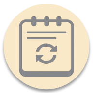
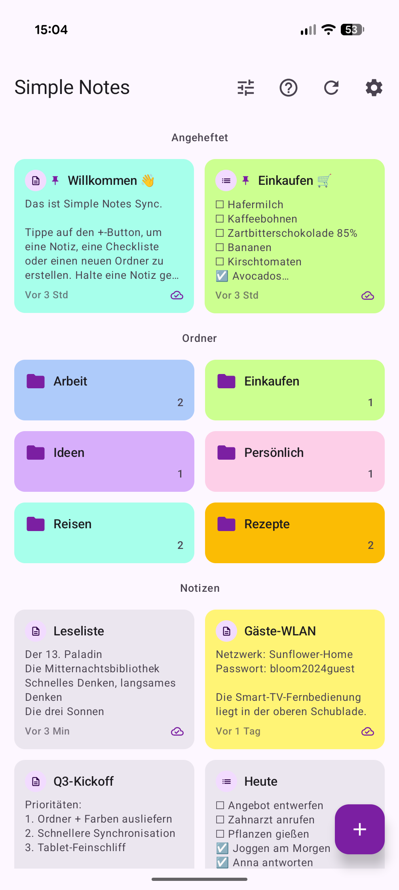
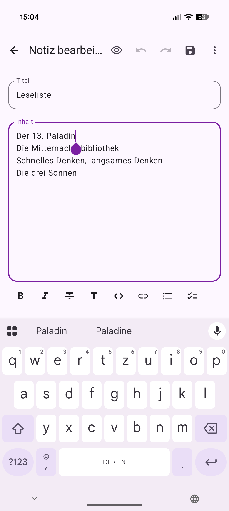
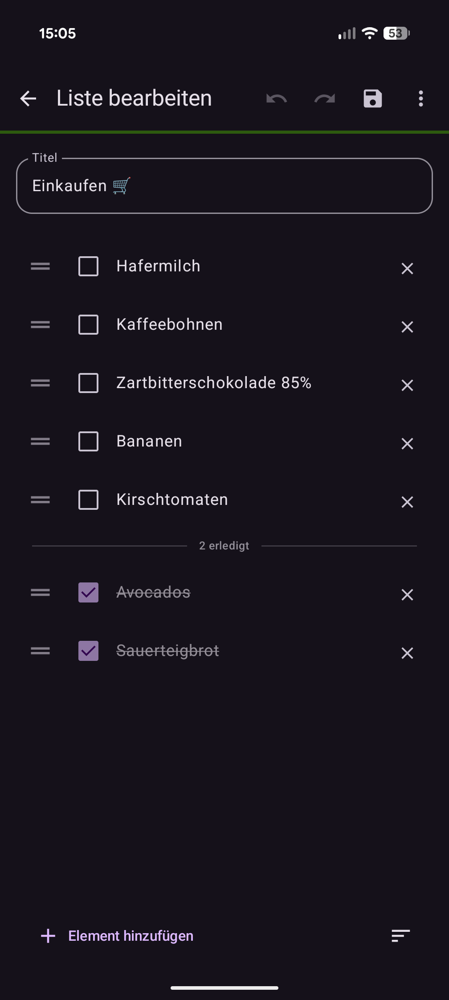
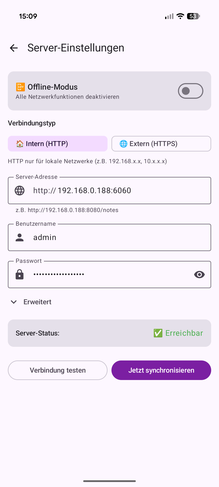
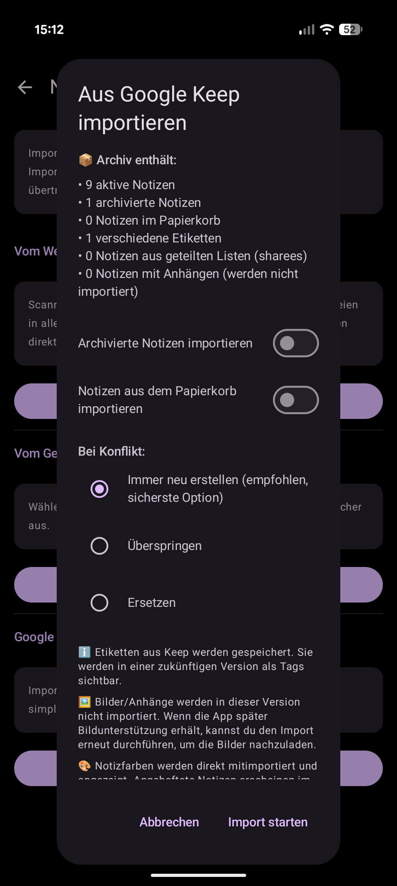
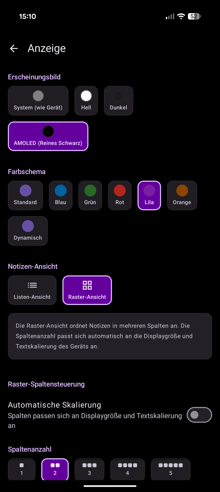

<div align="center">

</div>

<h1 align="center">Simple Notes Sync</h1>

<div align="center">

[](https://github.com/inventory69/simple-notes-sync/releases/latest)
[](https://www.android.com/)
[](LICENSE)
[](https://liberapay.com/inventory/)

<a href="README.md">English</a> · <strong>Deutsch</strong>

</div>

Notizen für Android, die offline funktionieren und mit deinem eigenen WebDAV-Server synchronisieren. Kein Konto, keine Cloud, kein Tracking.

Ich habe die App gebaut, damit sich meine Notizen von selbst mit dem WebDAV-Server zu Hause abgleichen, sobald ich heimkomme. Das ist bis heute der Kern. Alles andere ist drumherum gewachsen, und ohne Server funktioniert die App genauso.

<p align="center">
  
  
  
  
  
  
</p>

## Installieren

[F-Droid](https://f-droid.org/packages/dev.dettmer.simplenotes) · [IzzyOnDroid](https://apt.izzysoft.de/fdroid/index/apk/dev.dettmer.simplenotes) · [Google Play](https://play.google.com/store/apps/details?id=dev.dettmer.simplenotes) · [GitHub Releases](https://github.com/inventory69/simple-notes-sync/releases/latest) (mit [Obtainium](https://github.com/ImranR98/Obtainium) automatisch aktuell)

SHA-256 des Signaturzertifikats: `42:A1:C6:13:BB:C6:73:04:5A:F3:DC:81:91:BF:9C:B6:45:6E:E4:4C:7D:CE:40:C7:CF:B5:66:FA:CB:69:F1:6A`

## Schnellstart

**Server** (jeder Rechner mit Docker):

```bash
git clone https://github.com/inventory69/simple-notes-sync.git
cd simple-notes-sync/server
cp config.yml.example config.yml   # Passwort unter users: setzen
docker compose up -d
```

**App:** Einstellungen → Server-Einstellungen, Offline-Modus ausschalten, URL `http://SERVER-IP:8080/`, Benutzer `noteuser` und das Passwort aus `config.yml` eintragen, dann **Verbindung testen**.

Nextcloud oder einen anderen WebDAV-Server hast du schon? Dann reicht der App-Teil.

## Alles Weitere

Die Dokumentation gibt es nur auf Englisch, maßgeblich ist die [englische README](README.md). Von dort geht es zum ausführlichen [Schnellstart](QUICKSTART.md), zur [Funktionsliste](docs/FEATURES.md) und zur [Fehlersuche](docs/TROUBLESHOOTING.md).

Übersetzen kannst du auf [Weblate](https://hosted.weblate.org/engage/simple-notes-sync/). Lizenz: [AGPL v3](LICENSE).
