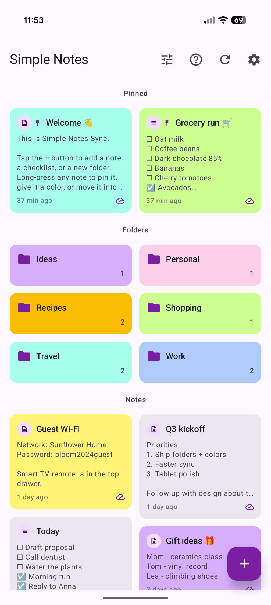
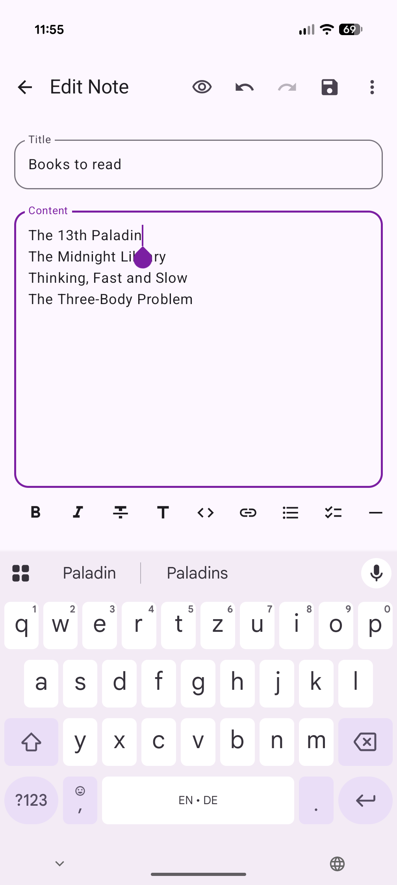
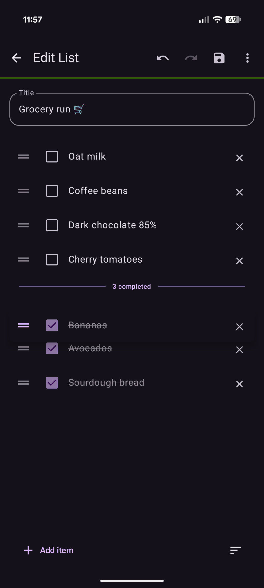
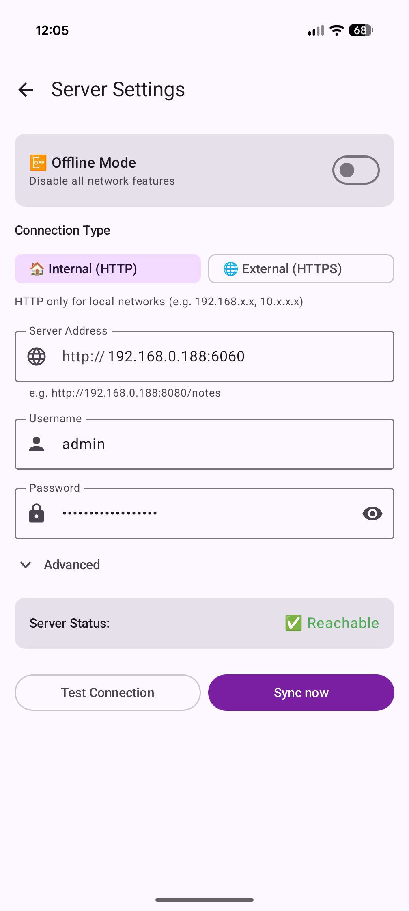
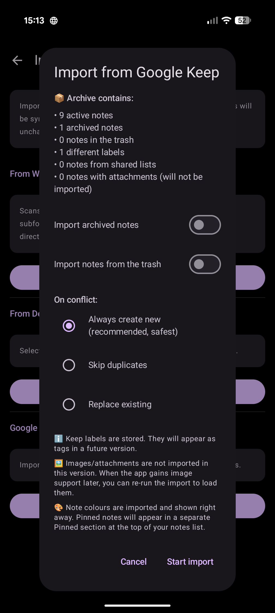
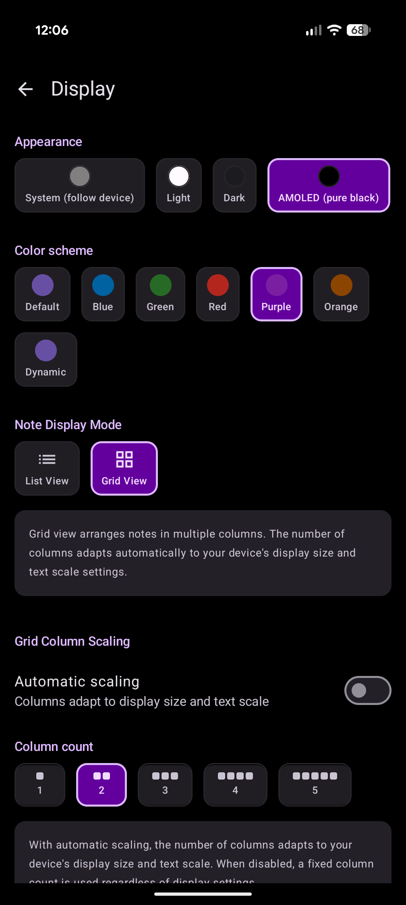

<div align="center">

</div>

<h1 align="center">Simple Notes Sync</h1>

<div align="center">

[](https://github.com/inventory69/simple-notes-sync/releases/latest)
[](https://www.android.com/)
[](LICENSE)
[](https://liberapay.com/inventory/)

</div>

<div align="center">

<a href="https://apt.izzysoft.de/fdroid/index/apk/dev.dettmer.simplenotes">
</a>

<a href="https://apps.obtainium.imranr.dev/redirect.html?r=obtainium://add/https://github.com/inventory69/simple-notes-sync">

</a>

<a href="https://f-droid.org/packages/dev.dettmer.simplenotes">
</a>

<a href="https://play.google.com/store/apps/details?id=dev.dettmer.simplenotes">
</a>

</div>

<div align="center">
<strong>SHA-256 hash of the signing certificate:</strong><br />42:A1:C6:13:BB:C6:73:04:5A:F3:DC:81:91:BF:9C:B6:45:6E:E4:4C:7D:CE:40:C7:CF:B5:66:FA:CB:69:F1:6A
<br /><br />
<strong>English</strong> · <a href="README.de.md">Deutsch</a>
</div>

Notes for Android that work offline and sync with your own WebDAV server. No account, no cloud, no tracking.

I built this so my notes would sync with the WebDAV server at home on their own, as soon as I get home. That is still the core idea. Everything else grew around it, and the app works just as well without any server.

<p align="center">
  
  
  
  
  
  
</p>

## Highlights

- **Your server, no account.** Notes live on your phone and sync with any WebDAV server: Nextcloud, ownCloud, a NAS or the small Docker server in this repo. Without a server the app works just as well.
- **No silent overwrites.** If a note changed on two devices, you compare both versions side by side and pick the one that stays.
- **Markdown that pastes well.** Live highlighting, tables and a preview. Pasting from a web page, Word or Google Docs keeps headings, lists, links and tables. Share a note as a PDF with formatting and images.
- **Images in notes.** Paste or pick them, resize them, place several side by side.
- **Fast checklists.** Drag an item across the divider to check it, unchecking puts it back where it was, and a read mode turns a list into tap to check.
- **Widgets you can write in.** Edit a note in a small card over the home screen and check items right in the widget.
- **Obsidian and desktop.** Optional Markdown copies of every note on the server, edits made there come back into the app. [Simple Notes Desktop](https://github.com/inventory69/simple-notes-desktop) for Windows and Linux uses the same folder.
- **Coming from Google Keep?** Import a Takeout export, checklists and colors included.
- **Private by design.** Local only folders that never leave the phone, app lock, encrypted backups, no analytics and no Google services. 12 languages.

All features: [docs/FEATURES.md](docs/FEATURES.md)

## Quick start

**Server** (any machine with Docker):

1. Get the server files:
   ```bash
   git clone https://github.com/inventory69/simple-notes-sync.git
   cd simple-notes-sync/server
   ```
2. Create the config and set a password under `users:`:
   ```bash
   cp config.yml.example config.yml
   ```
3. Start it:
   ```bash
   docker compose up -d
   ```

**App:**

1. Install it from one of the stores above.
2. Open Settings → Server Settings, switch off Offline Mode and enter
   URL `http://SERVER-IP:8080/`, username `noteuser` and the password from `config.yml`.
3. Tap **Test Connection**. From now on your notes sync on their own.

Already running Nextcloud or another WebDAV server? Skip the server part. The [quick start guide](QUICKSTART.md) covers that, HTTPS and when the app syncs in the background.

## What's next

Optional end-to-end encryption for the sync folder is in the works ([#9](https://github.com/inventory69/simple-notes-sync/issues/9)). There is no release date yet. Ideas and votes on what comes after that live in [Discussions](https://github.com/inventory69/simple-notes-sync/discussions/categories/ideas).

## Documentation

- [Quick start](QUICKSTART.md): server, app, background sync, self-signed certificates, updates
- [Features](docs/FEATURES.md): everything the app does, and the permissions it asks for
- [Sync](docs/SYNC.md): what lands on the server, conflicts, deletions, Markdown files and the desktop app
- [Backup](docs/BACKUP.md): backup files, encryption and restore modes
- [Troubleshooting](docs/TROUBLESHOOTING.md): ordered checks for the common problems
- [Server](server/README.md): the Docker server in detail
- [Changelog](CHANGELOG.md)

## Contributing

Bug reports and pull requests are welcome, see [CONTRIBUTING.md](CONTRIBUTING.md). Feature ideas go to [Discussions](https://github.com/inventory69/simple-notes-sync/discussions/categories/ideas).

Translations happen on [Weblate](https://hosted.weblate.org/engage/simple-notes-sync/), which hosts this project for free. Thank you!

[](https://hosted.weblate.org/engage/simple-notes-sync/)

If the app is useful to you, you can support it on [Liberapay](https://liberapay.com/inventory/).

## License

GNU Affero General Public License v3.0, see [LICENSE](LICENSE).
